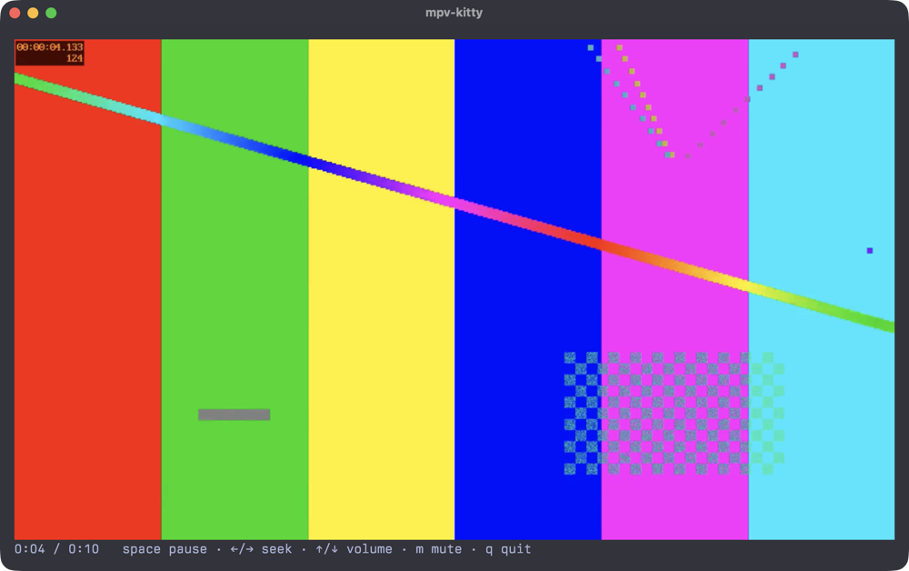

# mpv-kitty

A Rust library that plays video inside any rectangle of a terminal. mpv decodes the file, plays the audio, keeps time, seeks and runs playlists. mpv-kitty relays its frames through the kitty graphics protocol, so the terminal draws real pixels and scales them to the box on the GPU. The rest of your UI stays on screen around the video.



## Terminals

| Terminal | Frames travel as | Bytes per frame |
|---|---|---|
| kitty on the same machine | a POSIX shared-memory object, named in one short escape | about 100 |
| Ghostty, WezTerm | base64 through the pty, at up to 1280×720 | about 3.7 MB |
| any of them over ssh | base64 through the pty, at up to 640×360 | about 0.9 MB |

tmux and zellij don't pass the kitty graphics protocol through, so `kitty_graphics()` returns false inside them. Other terminals can use mpv's own `--vo=tct` text output.

## Requirements

- mpv on `PATH`. Tested with mpv 0.41 and kitty 0.48.
- Unix for the embedded `Player`. The foreground `run` also builds elsewhere and uses base64 there.

## Embedding

`Player` starts mpv with its terminal input off and never writes to the terminal itself. `render` returns the bytes that draw the newest frame in your box, and you write them when you draw.

```rust
use std::io::Write;
use mpv_kitty::{Options, Player, Viewport};

// An 80×24-cell box whose cells are 10×20 pixels.
let view = Viewport { columns: 80, rows: 24, pixel_width: 800, pixel_height: 480 };
let mut mpv = vec!["mpv".to_string()];
mpv.extend(mpv_kitty::audio_args());
mpv.extend(["--".into(), "clip.mp4".into()]);

let mut player = Player::start(&mpv, view, Options::detect())?;
let mut out = std::io::stdout();
while !player.tick()? {
    if let Some(bytes) = player.render(0, 0, view, false)? {
        out.write_all(bytes)?;
        out.flush()?;
    }
    // Read your input here, for example crossterm::event::poll(2 ms).
}
out.write_all(mpv_kitty::clear().as_bytes())?;
```

`toggle_pause`, `seek`, `add_volume`, `toggle_mute`, `set_speed` and `command` (any mpv input command as JSON) control playback. `progress()` reports the position, duration and pause state from mpv's IPC socket, which is enough for a seek bar.

kitty draws images above text. Write `clear()` before you draw a menu over the video, then call `render` with `force` set to put the frame back.

`examples/play.rs` is a complete player with a status line:

```
cargo run --release --example play -- clip.mp4
```

## Foreground playback

`run` hands the terminal to mpv, with its own key bindings, OSD and audio, and relays the frames until mpv exits. Shared-memory frames wait until the terminal has opened them.

```rust
let status = mpv_kitty::run(&mpv, view, Options::detect(), &mut std::io::stdout())?;
```

## How it works

mpv's `--vo=kitty` output writes each frame as base64 packets to its stdout. A reader thread parses those packets and, for local kitty, decodes each 4 KB chunk as it arrives straight into a new shared-memory object for that frame. The terminal then receives one escape that names the object; kitty maps it and unlinks it. Every frame gets its own object, so a slow terminal never reads a frame that the next one has already overwritten (mpv's own `--vo-kitty-use-shm` reuses one name). Objects the terminal never claims are unlinked after 30 newer frames and when playback stops.

Frames alternate between two image ids, and the previous id is deleted only after the new frame is placed. Sending a new frame to the id on screen makes kitty hide it until the upload finishes, which flickers.

mpv renders at most 1280×720 and the terminal scales to the box. mpv runs with `--profile=sw-fast`, `--hwdec=auto-copy` and `--zimg-threads=1`; zimg's default threading splits frames into column strips whose edges don't match and leaves a vertical seam in the picture.

`audio_args()` returns mpv options for low-latency sound. On macOS mpv 0.41 picks its AVFoundation output, which keeps about 2 seconds of audio behind the volume control. The options ask for CoreAudio with 16-bit samples (about 26 ms) and keep AVFoundation as the fallback.

## License

MIT
