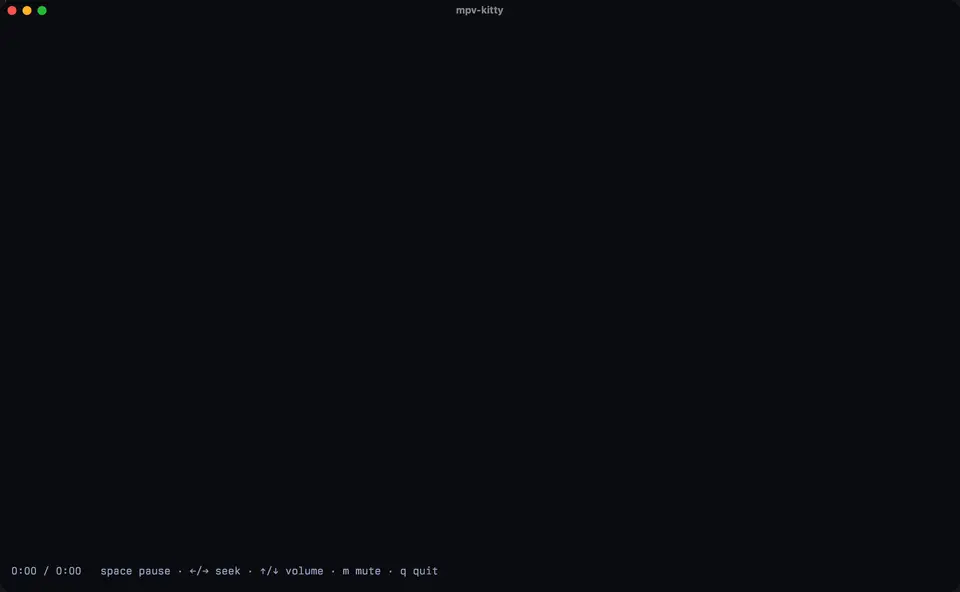
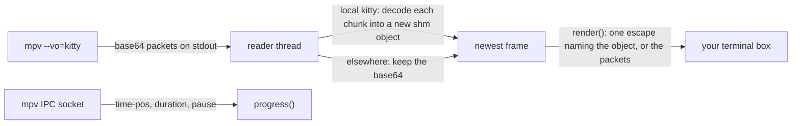

# mpv-kitty

[](https://github.com/safzanpirani/mpv-kitty/actions/workflows/ci.yml)
[](LICENSE)

A Rust library that plays video inside any rectangle of a terminal. mpv decodes
the file, plays the audio, keeps time, seeks and runs playlists. mpv-kitty
relays its frames through the kitty graphics protocol, so the terminal draws
real pixels and scales them to the box on the GPU. The rest of your UI stays on
screen around the video.



<sub>The bundled example player in kitty 0.48 on macOS, recorded from the
screen. Playback ran at the clip's 60 fps; the recording is shown at 30 fps.
Big Buck Bunny © Blender Foundation, [CC BY 3.0](https://creativecommons.org/licenses/by/3.0/).</sub>

## Try it

```sh
git clone https://github.com/safzanpirani/mpv-kitty && cd mpv-kitty
cargo run --release --example play -- clip.mp4
```

Space pauses, ←/→ seek 5 s, ↑/↓ change the volume, `m` mutes, `q` quits. Run it
in kitty, Ghostty or WezTerm, outside tmux.

To use the library, add it from git (it is not on crates.io yet):

```toml
[dependencies]
mpv-kitty = { git = "https://github.com/safzanpirani/mpv-kitty", tag = "v0.1.1" }
```

It needs mpv on `PATH`. It is tested with mpv 0.41 and kitty 0.48. The embedded
`Player` is Unix only; the foreground `run` also builds elsewhere and sends
base64 there.

## Terminals

| Terminal | Frames travel as | Bytes per frame |
|---|---|---|
| kitty on the same machine | a POSIX shared-memory object, named in one short escape | about 100 |
| Ghostty, WezTerm | base64 through the pty, at up to 1280×720 | about 3.7 MB |
| any of them over ssh | base64 through the pty, at up to 640×360 | about 0.9 MB |

tmux and zellij don't pass the kitty graphics protocol through, so
`kitty_graphics()` returns false inside them. Other terminals can use mpv's own
`--vo=tct` text output.

Frame rates measured in a 200×50-cell pty at 2400×1250 px, with mpv rendering a
1280×667 surface and a stand-in terminal that reads and unlinks each frame:

| Transfer | 30 fps clip | 60 fps clip | Per frame |
|---|---|---|---|
| shared memory (`Transfer::Shm`) | 30.3 fps | 60.2 fps | 0.1 KB |
| base64 (`Transfer::Direct`) | 26.6 fps | 24.9 fps | 3.2 MB |

## Embedding

`Player` starts mpv with its terminal input off and never writes to the
terminal itself. `render` returns the bytes that draw the newest frame in your
box, and you write them when you draw.

```rust
use std::io::Write;
use mpv_kitty::{Options, Player, Viewport};

// An 80×24-cell box whose cells are 10×20 pixels.
let view = Viewport { columns: 80, rows: 24, pixel_width: 800, pixel_height: 480 };
let mut mpv = vec!["mpv".to_string()];
mpv.extend(mpv_kitty::audio_args());
mpv.extend(["--".into(), "clip.mp4".into()]);

let mut player = Player::start(&mpv, view, Options::detect())?;
let mut out = std::io::stdout();
while !player.tick()? {
    if let Some(bytes) = player.render(0, 0, view, false)? {
        out.write_all(bytes)?;
        out.flush()?;
    }
    // Read your input here, for example crossterm::event::poll(2 ms).
}
out.write_all(mpv_kitty::clear().as_bytes())?;
```

| Call | Does |
|---|---|
| `Player::start(mpv, view, options)` | starts mpv from your argv, adding the kitty output, its sizing and the embedding flags before `--` |
| `tick()` | takes the newest frame without waiting; true once mpv has exited and its last frame is drawn |
| `render(column, row, view, force)` | the bytes that draw the newest frame centred in the box at that cell, or `None` when nothing changed |
| `has_frame()`, `has_new_frame()` | whether a first frame or an undrawn frame is waiting |
| `toggle_pause`, `seek`, `add_volume`, `toggle_mute`, `set_speed` | playback controls over mpv's IPC socket |
| `command(json)` | any mpv input command |
| `progress()` | position, duration and pause state, enough for a seek bar |
| `clear()`, `is_video_id(id)` | the escape that removes the video's images; whether an image id is one of the video's two |
| `Options::detect()` | the transfer and surface size for this terminal; `Transfer::parse` reads a user override |

kitty draws images above text. Write `clear()` before you draw a menu over the
video, then call `render` with `force` set to put the frame back.
`examples/play.rs` is a complete player in under 100 lines, with resizing and a
status line.

## Foreground playback

`run` hands the terminal to mpv, with its own key bindings, OSD and audio, and
relays the frames until mpv exits. Shared-memory frames wait until the terminal
has opened them.

```rust
let status = mpv_kitty::run(&mpv, view, Options::detect(), &mut std::io::stdout())?;
```

## How it works



mpv's `--vo=kitty` output writes each frame as base64 packets to its stdout. A
reader thread parses those packets and, for local kitty, decodes each 4 KB
chunk as it arrives straight into a new shared-memory object for that frame.
The terminal then receives one escape that names the object; kitty maps it and
unlinks it. Every frame gets its own object, so a slow terminal never reads a
frame that the next one has already overwritten. mpv's own
`--vo-kitty-use-shm` reuses one name, and releases up to 0.41.0 drop its leading
`/`, so on macOS it shows nothing (fixed in mpv's development branch by
[`e5a74aa`](https://github.com/mpv-player/mpv/commit/e5a74aaaa)). Objects the
terminal never claims are unlinked after 30 newer frames and when playback stops.

Frames alternate between two image ids, and the previous id is deleted only
after the new frame is placed. Sending a new frame to the id on screen makes
kitty hide it until the upload finishes, which flickers.

mpv renders at most 1280×720 and the terminal scales to the box. mpv runs with
`--profile=sw-fast`, `--hwdec=auto-copy` and `--zimg-threads=1`; zimg's default
threading splits frames into column strips whose edges don't match and leaves a
vertical seam in the picture. Options you pass to mpv come after these
defaults, so yours win.

`audio_args()` returns mpv options for low-latency sound. On macOS mpv 0.41
picks its AVFoundation output, which keeps about 2 seconds of audio behind the
volume control. The options ask for CoreAudio with 16-bit samples (about
26 ms) and keep AVFoundation as the fallback.

## License

MIT. The demo recording shows Big Buck Bunny, © Blender Foundation, licensed
under [CC BY 3.0](https://creativecommons.org/licenses/by/3.0/).
